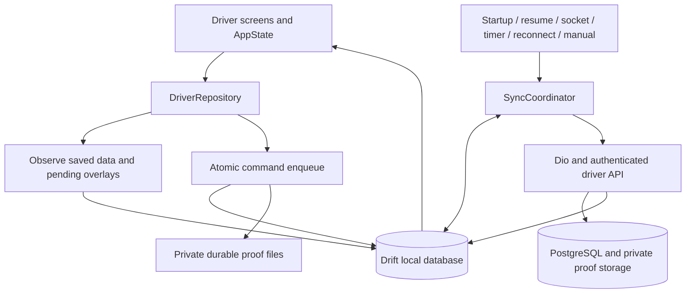

# Offline-First Architecture with Automatic Synchronization

Prepared: 2026-11-11 (Asia/Manila).

Status: **PARTIALLY — source implementation completed; native device acceptance, staging pilot and production rollout remain outstanding.**

Target: HYOps Flutter driver app in `hyops_flutter`, with supporting API changes in `hy_ops/backend`. The original design below now has a source implementation. No configured/production database was migrated and no service was deployed. [OFFLINE_ARCHITECTURE.md](OFFLINE_ARCHITECTURE.md) describes the implemented behavior; [OFFLINE_SYNC_ACCEPTANCE_REPORT.md](OFFLINE_SYNC_ACCEPTANCE_REPORT.md) separates automated verification from outstanding native/release work.

## Implementation record (2026-11-11)

| Phase | Status | Result |
| --- | --- | --- |
| 1: backend consistency contracts | COMPLETED | Actor-scoped transactional receipts, immutable request hashes, receipt lookup, stable error codes, trip version results, pickup trip-version guard, capability and rollout gate; additive migration generated and verified in a disposable database |
| 2: durable local storage | COMPLETED | Drift v1/v2-to-v3 migrations, confirmed entity records, query snapshots, outbox, attachment metadata, downloaded photo cache, scoped leases, file recovery and explicit change notifications |
| 3: local-first reads | COMPLETED | Saved data renders before refresh; pending overlays remain separate; outdated trip responses cannot overwrite newer versions; missing pages remain explicit |
| 4: durable supported writes | COMPLETED | Delivery/failure, full-order return collection and private proofs queued through one online/offline path; proof dependencies and eligibility enforced |
| 5: foreground synchronization | COMPLETED | Coalesced triggers, persistent retry timing, receipt recovery, ordered version bridging, conflict/auth handling and reconciliation |
| 6: UI/session lifecycle | COMPLETED | Pending labels/counts/progress, queue review/discard, separate upload/download times, stable verified-account namespace, revocation quarantine and explicit logout discard |
| 7: native scheduling | PARTIALLY | Workmanager pinned; worker, Android/iOS scheduling and platform setup implemented; build, locked-device, suspension and physical background acceptance remain unverified |
| 8: pilot/release | NOT IMPLEMENTED | Requires target migration review, staging/device acceptance, backend configuration and coordinated deployment |

Implementation choices: existing `driver_read_cache` snapshots provide page membership/filter/total storage instead of duplicating `local_query_pages`. Confirmed entity tables retain versioned API JSON. Queue processing uses concurrency one with independent-trip conflict isolation. New queued writes default off through the database setting `mobile_offline_delivery_recording_enabled`; disabling enqueueing preserves existing drains. Pending evidence is never automatically expired: approaching 30 days prompts review, while an unresolved-evidence deletion policy remains an operational decision. Confirmed/reconciled local proof files are eligible for seven-day cleanup.

Follow-up: read-only offline mode now permits opening the photo viewer; downloaded photos and retained uploaded proofs remain available independently of write eligibility. Downloaded photo bytes have a separate seven-day/100 MB scoped cache, upgraded locally from schema v2 to v3. Unavailable recording now explains the server/remembered-session prerequisite, and online refresh rechecks capability changes. No additional PostgreSQL migration or configured-database change was made for this correction.

## 1. Intended result

Drivers should open downloaded assignments immediately, capture delivery evidence and record supported delivery actions without a connection, and have those actions synchronize automatically when the authenticated backend becomes reachable. A local action must visibly remain pending until the server accepts it.

Example: a driver on an already dispatched trip loses connectivity, captures a photo, and records delivery. Both survive closing and reopening the app. When connectivity returns, the app validates the session, checks the assignment, uploads the proof, submits the delivery once, and reconciles the local view with the server. If staff reassigned the trip, the app shows a conflict instead of silently recording the delivery.

## 2. Current implementation and gaps

Reviewed against the current workspace source, rather than assuming earlier handoff documents describe every current file.

| Area | Current behavior | Required change |
| --- | --- | --- |
| Local storage | `lib/data/local/driver_cache_database.dart`: Drift/SQLite schema v1, JSON responses in `driver_read_cache`, seven-day expiry | Add structured local records, durable commands, attachments, query membership, and sync metadata |
| Reads | `lib/repositories/driver_repository.dart`: API first, cached responses after transport failure | Emit saved data immediately; refresh in the background and observe database changes |
| Writes | Repository, state and HTTP guards block offline operational actions | Route explicitly supported actions through a durable local outbox |
| Session isolation | `lib/api/api_client.dart`: cache scoped to API origin and refresh-session hash; generation guards and invalidation | Preserve isolation while defining stable queue ownership across token refresh and restart |
| Delivery commands | Outcomes and return collection carry operation keys and versions | Audit and extend replay contracts for durable, ordered retries |
| Other commands | Trip start has a version without an operation key; stop planning uses an action without a version/key | Keep these online-only in the first release |
| Proofs | Photo/signature drafts are held by `proof_sheet.dart`; uploads require connectivity | Persist private files and upload dependencies before displaying a successful local save |
| Automatic refresh | `app_state.dart`: socket events, resume and configurable foreground polling; default 30 seconds | Feed all triggers into one synchronization coordinator |
| User feedback | `widgets/sync_panel.dart`: offline/read-only and refresh feedback | Show pending count, upload progress, conflicts and separate pull/push timestamps |

Retain Drift, Dio, secure credential storage, assignment sockets, existing server business rules, and the current Flutter state approach. A state-management rewrite or replacement backend is unnecessary for this feature.

## 3. Scope and proposed operating policy

These are implementation defaults, not new claims about existing behavior.

| Workflow | First release policy |
| --- | --- |
| Profile, assignments, trip details, loaded history | Local-first reads with background reconciliation |
| Delivered/failed outcome | Queue for previously downloaded, server-dispatched active trips; delivery requires durable proof dependencies |
| Photos and signatures | Capture offline and persist privately; upload automatically |
| Refunded-goods collection | Queue for previously downloaded pickups; retain current full-order collection rules |
| Trip start/dispatch | Online-only because timing, stock, availability and dispatch authorization need current server validation |
| Skip/prioritize stop | Online-only initially; a separate versioned/idempotent contract is needed before queueing |
| Payments, refunds, stock adjustments, warehouse receipt | Preserve existing server/staff workflows |
| GPS | Preserve live tracking behavior; historical GPS replay is a separate feature |
| Maps and road routes | Preserve existing online providers; offline tile/route downloads are outside this release |
| Fresh password login | Requires server authentication; remembered verified sessions may reopen saved data |

Proposed offline write eligibility: same remembered account and API environment, downloaded active assignment, and a successful authorization/assignment check within the last 24 hours. Older data may remain readable within the existing seven-day policy, but new operational writes require reconnection. Keep this threshold configurable and validate it with operations before enabling offline writes in production. The server checks ownership and eligibility again on submission regardless of local age.

## 4. Architecture

The local database supplies the UI. The server remains authoritative for accepted operational outcomes, ownership, versions, inventory and financial state. The displayed trip combines confirmed records with clearly marked pending local actions; synchronization must never overwrite an unsent action with a downloaded snapshot.

Use repository streams and explicit Drift table invalidation/watch registration. The existing database uses custom SQL and declares no generated tables, so custom writes need deliberate stream notification or typed tables; merely adding a watch call is insufficient.

## 5. Local data model and migration

Extend the existing database with a versioned, additive migration. Final column types and indexes should follow the actual API models.

| Table | Essential fields and purpose |
| --- | --- |
| `local_driver_profiles` | Scope, driver ID, validated payload, saved time |
| `local_trips`, `local_stops`, `local_return_pickups` | Scoped server IDs, relationships, confirmed payload/status/version, fetched time |
| `local_history` | Scoped confirmed outcome records and fetched time |
| `local_query_pages` | Scoped endpoint/filter/page identity, ordered record IDs, total, fetched time, completeness |
| `sync_outbox` | Command UUID, operation key, scope/actor, kind, trip/entity IDs, immutable payload/hash, original version, resolved send version, sequence, dependencies, state, attempt count, retry time, error code, lease owner/expiry, created time |
| `local_attachments` | Attachment UUID, scope/stop, private file path, kind, MIME type, size, hash, upload operation key, upload state, server proof ID |
| `sync_metadata` | Last validated session/assignment time, successful pull/push times and reconciliation state per scope |

Required invariants:

- Unique operation keys and ordered commands within each trip; prevent conflicting pending outcomes for the same stop.
- Confirmed server records and pending overlays stay separate. Never invent a server version for an unsent action.
- Each saved user action commits its outbox row, dependencies and local overlay atomically. If the database write fails, do not show the action as saved.
- Save proof files through a temporary file and atomic rename before committing their database references. File and SQLite transactions are separate: reconcile orphan files and detect missing files on startup.
- Preserve downloaded-page membership; one page does not establish a complete assignment list. A missing page is unavailable, not an empty result.
- Keep existing v1 snapshots during transition; import valid scoped data where possible and redownload incompatible records. Test upgrading an actual v1 file.
- Seven-day cache cleanup must not delete pending commands, referenced entities or required proofs. Prune confirmed cache records independently.

Keep tokens out of SQLite. Use an app-private directory for proof files and exclude sensitive pending files/database from cloud backup or device transfer where appropriate. Existing SQLite is not encrypted; document this and evaluate device-protected storage/encryption requirements before production. Do not claim private storage alone provides encryption.

## 6. Durable write and attachment flow

1. Validate local eligibility, required fields, file limits and duplicate/pending actions.
2. Generate and persist an operation UUID once; retries and restarts reuse it.
3. Persist photo/signature files in durable app-private storage, retaining the existing limits of three photos, one signature and 5 MB per proof. Check supported formats locally; the server still validates and normalizes content.
4. In one database transaction, save attachment metadata, upload commands, the outcome command and dependency edges, plus the pending overlay.
5. Return a local-save result to the UI: **Saved on device — pending sync**.
6. Request synchronization immediately, including while online. Online and offline supported actions use the same queue.
7. Submit proof uploads first. Submit delivery only after its required proofs are acknowledged. A failed upload blocks the dependent delivery without discarding it.
8. On acknowledgment, atomically persist the result and mark the command acknowledged. Reconcile the affected trip/history; remove the overlay when confirmed data represents the accepted action.
9. Delete temporary proof files only after acknowledgment, reconciliation and the chosen retention window. Keep metadata needed to explain the action.

An accepted command followed by a failed refresh remains accepted with reconciliation pending. A read failure must not turn it back into an unsent write. Do not allow editing or canceling a command that may already have reached the server; reconcile its operation key first. Unsent edits create a new command/key and preserve dependency consistency.

## 7. Synchronization coordinator

Create one coordinator outside widget lifecycle code; inject repository, clock, transport and scheduler interfaces for verification.

Triggers: local enqueue, app startup after session restoration, app resume, assignment socket reconnect/event, existing configured refresh interval, optional connectivity-change hints, and manual **Sync now**. A connectivity hint requests a run; Wi-Fi presence never proves API reachability.

Each run:

1. Coalesce triggers and acquire a database-backed scoped lease; foreground and background workers share it. Recover expired leases after crashes.
2. Validate/refresh authentication through the existing session manager. Pause on authentication failure; never use another account's credentials.
3. Pull current affected assignment state and resolve known ambiguous commands. Do not remove local overlays during this pull.
4. Claim eligible commands in dependency and trip sequence order. Serialize all writes that can advance the same trip version, including return collection. Permit bounded concurrency across independent trips.
5. Upload proofs and submit eligible commands with their saved operation keys.
6. Commit acknowledgments and reconcile affected records. Invalidate/reload relevant query pages and loaded history so pagination and totals remain accurate.
7. Persist retry times and release the lease. A partial failure leaves other independent work eligible.

Persist command states: `pending`, `in_flight`, `retry_wait`, `blocked_auth`, `blocked_dependency`, `conflict`, `rejected`, `acknowledged`. Track reconciliation separately from command acceptance. Recover abandoned `in_flight` work by replaying the same operation key after lease expiry.

Retry transport failures, timeouts, selected transient server failures and rate limits with bounded exponential backoff plus jitter, for example 2 seconds to 5 minutes; honor `Retry-After`. Retain failed work visibly rather than deleting it after a retry limit. Pause certificate/configuration failures with an actionable error. Validation failures require correction; conflicts require reconciliation. A 401 gets one coordinated credential-refresh attempt, then blocks synchronization. A 403/404 may indicate lost assignment access and must stop affected writes rather than trigger endless retries.

Do not introduce generic automatic POST retries in Dio. The coordinator owns operational retries and preserves identity; audit the existing authentication retry interceptor for uploads and commands.

## 8. Server contracts and conflict handling

The current outcome policy in `driver/policy.ts` recognizes matching replay before rejecting a changed version, while enforcing current ownership in the service. Preserve this protection and test it under concurrent requests. Audit return collection and proof uploads to the same standard.

Required backend work before enabling queued writes:

- Persist operation identity, canonical request hash, actor, target and accepted result atomically with each business mutation. Same key/same request returns the stored result; same key/different request rejects. Use database uniqueness and row locks, not process memory.
- Provide an authorized operation-result lookup, or an equivalent authoritative replay response, to resolve a committed write whose HTTP response was lost. Acknowledged acceptance must remain distinguishable from current resource access after reassignment; return only minimal actor-scoped receipt data.
- Return stable machine-readable codes for version conflict, reassignment, canceled/completed work, proof requirement, invalid request and key reuse. Current message-based `WorkflowError` responses need an additive code field.
- Return accepted/current versions and canonical outcome identifiers. Retain operation receipts at least as long as any pending command can be replayed; unresolved work must not outlive its replay protection.
- Preserve existing transaction boundaries, stock rules, ownership checks and post-commit assignment events. Client timestamps are advisory capture times; server acceptance times remain authoritative.
- Keep existing clients compatible. Add the next migration through the actual current Drizzle journal; do not assume migration numbering from older workspace notes.

### Trip version sequencing

Multiple offline outcomes from one trip may all have captured the same base version. Replaying that version for every command will fail after the first accepted action increments the trip version.

Keep immutable user intent and original base version. For a command never submitted, resolve its send version only when prior trip commands are acknowledged and current state proves the only intervening relevant changes are those accepted local commands. Persist the resolved request before sending; freeze it across ambiguous retries. If other changes occurred or their provenance cannot be proven, stop with a conflict. Extend the API with revision/change metadata if current responses cannot establish this distinction. Never blindly replace a stale version with the latest value.

Conflict policy: no last-write-wins for operational outcomes. Reassigned, canceled, independently completed or materially changed work enters **Needs attention**, retaining captured evidence under the correct account. Block dependent commands while allowing independent trips to synchronize. Any corrected/resubmitted intent uses a new key after review; never silently reassign evidence to a different trip.

## 9. Session lifecycle and retention

The current scope hashes the API origin and refresh credential. Queue identity must survive ordinary credential rotation without becoming shareable across accounts. Define a stable local session/account namespace bound to a previously verified driver and API origin; migrate only after validated identity continuity. Do not merge old queues on email equality alone.

- Remembered offline startup may load saved data and eligible work; a fresh login still needs the server.
- On temporary auth/network failure, retain pending work and show its paused state.
- On definitive session revocation, stop workers, clear visible data/credentials and quarantine pending work from replay. Reauthentication as the same verified driver may recover it only after current access checks; otherwise require explicit discard under the retention policy.
- Before voluntary logout/account switch with pending work, show its count and offer sync first or explicit discard-and-logout. Logout remains possible offline. The discard path stops workers, invalidates generations and removes scoped queued data/files; never silently drop deliveries during an ordinary refresh failure.
- API environment changes cannot move commands to another server. Late responses from an old session cannot update the active account.
- Propose a 30-day maximum local evidence retention for unresolved work, with advance warnings and an explicit escalation/discard policy. Confirm operational/privacy requirements before rollout; do not silently expire pending deliveries.

## 10. User experience

Extend the existing sync panel with **Up to date**, **Offline — N changes saved**, **Syncing N changes**, **Sign in to sync**, and **N actions need attention**. Show last successful download separately from last uploaded change.

Trip/stop/pickup screens distinguish **Pending delivery**, **Pending failed attempt**, **Pending collection**, **Uploading proof**, and server-confirmed outcomes. Pending outcomes must not count as confirmed history or present server-generated receipts. Provide a queue view with safe retry and conflict details. Preserve pending stop visibility even if a local overlay would otherwise remove it from the active list.

First install without saved data shows a clear connection requirement. Missing pages and stale data remain explicit. Local storage full, permission denial or missing proof files must keep the form recoverable and must never display a successful save.

## 11. Foreground and background execution

Deliver reliable foreground synchronization first: enqueue, reconnect, resume, socket and timer triggers share the coordinator. It must work without a background plugin.

Then add native scheduling through a Flutter integration compatible with the installed SDK and platform targets, selected and pinned during implementation. Android persistent queue processing can use WorkManager with network constraints. iOS background tasks are scheduled by the OS; they cannot promise an exact reconnect time. Persist progress and handle expiration/cancellation. Restart/resume always reconciles pending work, even if no background task ran. See [Android offline-first guidance](https://developer.android.com/topic/architecture/data-layer/offline-first) and [Apple background strategy guidance](https://developer.apple.com/documentation/BackgroundTasks/choosing-background-strategies-for-your-app).

Workers need isolated initialization of the database, session store and authenticated client; do not depend on AppState or a widget being alive. Verify native secure-storage availability and file protection when locked, shared-database leases, platform permissions and task identifiers. Do not reuse GPS background permissions as a guarantee of sync execution. Test ordinary suspension, termination, OS force-stop and device restart separately; user force-stop can prevent scheduled execution until reopening.

## 12. Implementation phases and affected files

The table below retains the original deliverables and exit requirements. Actual status is recorded above; native and release exit requirements remain open.

| Phase | Deliverable | Primary files/areas | Exit requirement |
| --- | --- | --- | --- |
| 1 | Freeze queue policy, API receipts, codes and version-chain contract | `hy_ops/backend/src/modules/driver/{index,service,policy,proofs}.ts`, `modules/deliveries/customer-returns.ts`, schema/migrations, `DRIVER_API_CONTRACT.md` | Duplicate, ambiguous-response, ownership and sequential-version scenarios proven against disposable DB |
| 2 | Local schema, migration, observed reads and file persistence | `lib/data/local/driver_cache_database.dart`; proposed `driver_local_store.dart`, `outbox_store.dart`, `attachment_store.dart` | Upgrade from v1 and offline reopen preserve correct scoped data; storage failure cannot create false saves |
| 3 | Local-first repository reads | `lib/repositories/driver_repository.dart`, `lib/state/app_state.dart`, `lib/data/models.dart` | Saved data renders before delayed API response; pulls preserve pending work and pagination semantics |
| 4 | Durable supported writes and proof dependencies | Repository/state, `lib/services/offline_policy.dart`, `lib/features/trips/{proof_sheet,delivery_sheets}.dart` | Offline action and evidence survive restart; duplicate/conflicting input is prevented |
| 5 | Foreground automatic synchronization | Proposed `lib/services/sync_coordinator.dart`, `sync_scheduler.dart`; `api_client.dart`, assignment socket and lifecycle wiring | Ordered replay, auth recovery, backoff, ambiguous acknowledgment and conflicts pass |
| 6 | Sync UI and lifecycle cleanup | `lib/widgets/sync_panel.dart`, trip/history/profile/auth screens, session storage | Pending and confirmed results are clear; logout/account switch cannot leak or replay work |
| 7 | Native background execution | Android/iOS configuration, selected dependency, worker entry point | Real Android/iOS background/locked-device checks; recovery works when scheduling does not run |
| 8 | Staging pilot, documentation and controlled release | Existing integration harness, `OFFLINE_ARCHITECTURE.md`, README, root integration register | Acceptance evidence recorded; backend deployed before mobile writes enabled |

Phase order: 1 -> 2 -> 3 -> 4 -> 5 -> 6 -> 7 -> 8. Keep offline writes behind a capability/configuration gate until both server and mobile contracts pass. A server that lacks the capability must retain read-only offline behavior.

## 13. Verification and acceptance

Add meaningful tests to the existing Flutter offline, proof, session and automatic-refresh suites, plus dedicated outbox/coordinator tests using actual Drift/SQLite files and a controllable clock. Extend the existing disposable backend and mobile restart harness rather than using production services.

Required scenarios:

1. Download assignments; disconnect; restart; open saved data without waiting for a transport timeout.
2. Record proof and delivered/failed outcomes offline; force-stop/relaunch; verify commands, file hashes and pending labels persist.
3. Reconnect without tapping refresh; proofs upload before delivery; server records one outcome and local pending state clears after reconciliation.
4. Drop the response after a server commit; retry across restart with the same key; no duplicate mutation, proof, stock movement or history row.
5. Queue several stops and a return pickup on one trip; versions advance safely and commands remain ordered. Changes from another actor cause a visible conflict.
6. Reassign/cancel while the device is offline; old commands cannot bypass current ownership. Other trips still synchronize.
7. Expire credentials, revoke the session, rotate tokens, switch account/API origin and logout offline; no cross-account file/data exposure or replay.
8. Simulate disk full, corrupt snapshots, missing proof files, denied permissions and a crash between file rename/database commit; no false successful save.
9. Race timer/socket/manual/background triggers; one scoped drain operates and leases recover after process death.
10. Return 429, transient 5xx, validation failures, TLS errors and timeouts; verify classification, persisted backoff and retained work.
11. Exercise pagination/filter cache misses, removed assignments and changed history totals without overwriting unsent overlays.
12. Test Android and iOS background expiration, locked device and ordinary resume. Record platform limitations separately from unit-test results.

Use `flutter test --no-pub --concurrency=1` and `flutter analyze --no-pub --no-fatal-infos` from `hyops_flutter` after implementation. Run backend tests and the relevant disposable database/mobile suites from `hy_ops/backend`; check current harness options before running. A Markdown-only planning change does not require application tests.

Release acceptance: no pending work lost across restart, no duplicate server effect in ambiguous retries, no unauthorized replay, no optimistic UI mistaken for confirmation, and automatic foreground recovery verified. Native background acceptance must be recorded separately for each target platform.

## 14. Rollout, monitoring and rollback

Deploy additive server contracts/migrations first, then a mobile build with local-first reads, then enable queued writes for a staging pilot, then enable background workers after device acceptance. Record implementation using the workspace convention `NOT IMPLEMENTED | PARTIALLY | COMPLETED`; deployment and physical-device acceptance have separate evidence.

Measure queue depth/oldest age, upload failures, conflict count, command latency and reconciliation failures. Log operation IDs and error codes without tokens, customer payloads, images or signatures.

A rollback disables new offline enqueueing while a compatible engine continues draining or visibly pauses existing queues. Do not revert to an app that cannot read pending commands, drop additive tables, clear evidence, or bypass conflict rules. Keep queued payloads versioned and block unsupported versions visibly. Back up and review the actual migration target before production deployment.

## 15. Design references

The proposed design applies the repository/local-data approach described in [Flutter offline-first support](https://docs.flutter.dev/app-architecture/design-patterns/offline-first). Local database reads, durable command processing and platform scheduling are separate responsibilities; this plan specifies the HYOps-specific consistency rules.

Additional primary references: [Android offline-first architecture](https://developer.android.com/topic/architecture/data-layer/offline-first), [Apple background execution strategies](https://developer.apple.com/documentation/BackgroundTasks/choosing-background-strategies-for-your-app), and [Drift platform support](https://drift.simonbinder.eu/platforms/). Recheck package and platform compatibility when implementing native scheduling.
